<div align="center">

<a href="https://abhijeet-portfolio-orpin.vercel.app">
  <picture>
    <source media="(prefers-color-scheme: dark)" srcset="assets/hero-dark.svg">
    <source media="(prefers-color-scheme: light)" srcset="assets/hero-light.svg">
    
  </picture>
</a>

<br/>

<a href="https://abhijeet-portfolio-orpin.vercel.app"></a>
<a href="https://wa.me/919430322551?text=Hi%20Abhijeet%2C%20main%20aapse%20baat%20karna%20chahta%20hoon.%20Mujhe%20aapse%20kaam%20ke%20baare%20mein%20baat%20karni%20hai."></a>
<br/>
<a href="https://www.instagram.com/abhi.jeetkuumar/"></a>
<a href="https://www.linkedin.com/in/abhijeet-kumar-4b6a083b0/"></a>
<a href="https://x.com/Abhijeetkuumar"></a>
<a href="https://www.youtube.com/@AbhijeetKumarz7r"></a>
<a href="https://peerlist.io/abhijeetkuumar"></a>
<a href="https://www.freelancer.com/u/abhijeetk371"></a>

</div>

<br/>

## What I do.

<sub>7 SERVICES · ONE AI WORKFLOW · FIRST DEMO FREE</sub>

<a href="https://abhijeet-portfolio-orpin.vercel.app/#services">
  <picture>
    <source media="(prefers-color-scheme: dark)" srcset="assets/services-dark.svg">
    <source media="(prefers-color-scheme: light)" srcset="assets/services-light.svg">
    
  </picture>
</a>

<br/>

## My AI & Dev Stack.

<picture>
  <source media="(prefers-color-scheme: dark)" srcset="assets/stack-dark.svg">
  <source media="(prefers-color-scheme: light)" srcset="assets/stack-light.svg">
  
</picture>

<p align="center">
  
</p>

<br/>

## Things I've built.

<table>
<tr>
<td width="50%" valign="top">

### 🐘 [Yojana Saathi](https://github.com/abhi478jeetur-rgb/yojana-saathi)
Describe your life in English or Hinglish, and it finds the Indian government schemes you qualify for, why you match, and the documents you need.

`React` `Vite` `Appwrite` `GSAP`

<a href="https://yojana-saathi.appwrite.network/"></a>
<a href="https://github.com/abhi478jeetur-rgb/yojana-saathi"></a>

</td>
<td width="50%" valign="top">

### 🎬 [Solo Video Studio](https://github.com/abhi478jeetur-rgb/solo-video-studio)
A one-person AI video and audio toolkit: 10s splitter, watermark cleaner, silence cutter, storyboard generator.

`JavaScript` `AI tools`

<a href="https://solo-video-studio.vercel.app"></a>
<a href="https://github.com/abhi478jeetur-rgb/solo-video-studio"></a>

</td>
</tr>
<tr>
<td width="50%" valign="top">

### ⏱️ [Clockivo](https://github.com/abhi478jeetur-rgb/clockivo.com-tool-website)
A clean, free timer, stopwatch and alarm built for deep focus.

`TypeScript` `Next.js`

<a href="https://www.clockivo.com/"></a>
<a href="https://github.com/abhi478jeetur-rgb/clockivo.com-tool-website"></a>

</td>
<td width="50%" valign="top">

### 🧬 [Human Atlas](https://github.com/abhi478jeetur-rgb/human-atlas)
An interactive way to explore the human body, because biology deserves better than textbooks.

`TypeScript`

<a href="https://human-atlas-mu-six.vercel.app/"></a>
<a href="https://github.com/abhi478jeetur-rgb/human-atlas"></a>

</td>
</tr>
<tr>
<td width="50%" valign="top">

### 🚗 [Car 3D](https://github.com/abhi478jeetur-rgb/car-3d)
A 3D car experience in the browser. Mostly built to find out if I could.

`TypeScript` `3D`

<a href="https://car-3d-one.vercel.app"></a>
<a href="https://github.com/abhi478jeetur-rgb/car-3d"></a>

</td>
<td width="50%" valign="top">

### 🎞️ [Video Machine](https://github.com/abhi478jeetur-rgb/video_machine)
A Python pipeline that automates the boring parts of making videos.

`Python` `automation`

<a href="https://github.com/abhi478jeetur-rgb/video_machine"></a>

</td>
</tr>
</table>

<p align="center"><a href="https://abhijeet-portfolio-orpin.vercel.app/gallery.html"><b>Explore the full gallery ↗</b></a></p>

<br/>

```js
const abhijeet = {
  mode:       "curious → prototype → ship → repeat",
  into:       ["AI agents", "web apps that feel alive", "AI video", "3D on the web"],
  rule:       "if it works only in my head, it doesn't work",
  right_now:  "turning messy real-world problems into small, useful tools",
};
```

## Currently curious about

- 🤖 multi-agent systems, and how AI agents can work together like a team
- 🎥 AI video, motion graphics and short-form storytelling
- 🧪 the overlap of biology and software
- ✨ interfaces that feel calm, warm and a little bit magical

<br/>

<picture>
  <source media="(prefers-color-scheme: dark)" srcset="https://raw.githubusercontent.com/abhi478jeetur-rgb/abhi478jeetur-rgb/output/github-snake-dark.svg">
  <source media="(prefers-color-scheme: light)" srcset="https://raw.githubusercontent.com/abhi478jeetur-rgb/abhi478jeetur-rgb/output/github-snake.svg">
  
</picture>

<br/><br/>

<a href="https://wa.me/919430322551?text=Hi%20Abhijeet%2C%20main%20aapse%20baat%20karna%20chahta%20hoon.%20Mujhe%20aapse%20kaam%20ke%20baare%20mein%20baat%20karni%20hai.">
  <picture>
    <source media="(prefers-color-scheme: dark)" srcset="assets/footer-dark.svg">
    <source media="(prefers-color-scheme: light)" srcset="assets/footer-light.svg">
    
  </picture>
</a>

<p align="center"><sub>always learning, occasionally sleeping ☕ · <a href="https://wa.me/919430322551?text=Hi%20Abhijeet%2C%20main%20aapse%20baat%20karna%20chahta%20hoon.%20Mujhe%20aapse%20kaam%20ke%20baare%20mein%20baat%20karni%20hai.">say hi on WhatsApp</a></sub></p>
